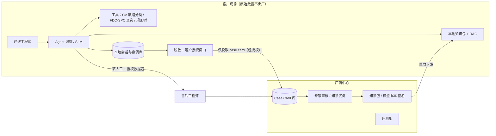

# 01 · 总体架构

## 1. 总览

- **Track A 设备端增配**：把设备变成“可观测、可预警、可调节”的数据源（采集 → FDC → APC → EAP/MES 接口）。
- **Track B 产线 Agent**：把你们的售后经验变成可规模化交付的诊断能力（知识库 + SLM 编排 + 工具 + 转人工）。
- **衔接点**：Track A 产出的 FDC 事件 / 参数趋势，是 Agent 后期的自动数据源。两边共用同一份**数据字典**（设备、工序段、症状、参数命名）。

---

## 2. Track A：设备端增配

| 层 | 内容 | 要点 |
|---|---|---|
| L0 传感与采集 | 设备原生 PLC 信号、补装传感器、协议适配（OPC UA / SECS-GEM / Modbus，视客户与设备而定） | 先做信号清点：现有哪些信号、缺哪些、按“对良率影响 × 获取成本”排序；统一时间同步与命名 |
| L1 边缘数据层 | 高频 trace 缓存、事件（报警 / 配方切换 / 维护）、时序存储 | 定保存周期与压缩策略；与 case card 字段对齐 |
| L2 FDC | 故障检测与分类 | 先单变量阈值 + 趋势 + SPC 控制图（v1），再多变量（v2），最后接 Agent 做故障分类 |
| L3 APC | Run-to-Run 反馈 / 前馈控制 | 只选 1–2 个高价值回路试点（如 PECVD 膜厚 / 折射率、扩散方阻、印刷湿重 / 对位）；先“建议模式”（人确认），后闭环；配方设上下限护栏 |
| L4 EAP / MES 接口 | 配方下发与版本管理、追溯 ID、状态上报、工单 | **定位为“设备侧接口 + 追溯字段”，与客户现有 MES 对接，不要替代它**；光伏常见按载具 / 批次（如石墨舟、载板）追溯，粒度先对齐客户 |

> 设计原则：APC 任何写入动作都必须有 ①参数上下限 ②变更日志 ③一键回退 ④人工确认模式。

---

## 3. Track B：Agent 架构（边缘 + 中心）

### 组件职责

| 组件 | 职责 |
|---|---|
| Agent 编排（SLM） | 状态机驱动的对话：归类、追问、调用工具、生成排查步骤、判断转人工 |
| 本地知识包 + RAG | 案例检索（主）、规则树、报警码表、手册 / 文献片段；只读、版本化 |
| 工具层 | EL / 外观缺陷分类（专用 CV 模型）、FDC / SPC 查询适配器、参数窗口计算、规则树引擎 |
| 本地案例库 | 存客户私有会话与结果；可被客户随时删除 |
| 脱敏 + 授权闸门 | 按 `02` 中的规则脱敏；每单经客户确认；审计日志 |
| 中心 Case Card 库 | 仅存脱敏卡；专家审核后进入知识包 |
| 知识包构建与签名 | 月度（或按需）发布；带适用范围与有效期；支持回滚 |

---

## 4. 对话流程（状态机）

1. **接入归类**：症状类别（良率 / 效率 / EL / 外观 / 碎片 / 设备报警）、紧急度、是否涉及安全。**安全 / 互锁类直接转人工。**
2. **上下文采集**：工序段、设备型号与编号、发生时间、近期变化（换料 / 换浆 / 维护 / 配方）、影响范围（单线 / 多线、单批 / 持续）、已尝试措施。提问顺序按“信息增益”排序，一次不超过 3 个问题。
3. **数据请求**：图片（EL / PL / 外观）、参数截图或 CSV（FDC trace、配方）、分选分档数据（Eta、Voc、Isc、FF、Rs、Rsh、Irev 等）。
4. **分析**：相似案例检索 + 规则树 + 工具结果 → 候选根因 + 置信度。
5. **输出**：排查步骤 1…N，按“概率高 / 成本低 / 风险低”排序；每步含**操作、判定标准、预期现象、不成立时的下一步、风险等级**。
6. **闭环**：客户回报每步结果 → 重新排序候选根因。
7. **转人工条件**：置信度低于阈值；连续 N 步无效；涉及安全 / 互锁 / 配方大改；客户主动要求。转人工附带完整上下文包（经授权）。
8. **结案与标签**：记录最终根因与**是否解决** → 客户确认后生成 case card。**“结果标签”是数据飞轮的关键。**

### 动作风险分级（护栏）

| 级别 | 含义 | 处理 |
|---|---|---|
| L0 | 只读检查（看参数、看日志、目检） | Agent 可直接建议 |
| L1 | 常规可逆调整（清洁、换耗材、窗口内微调） | 建议并注明回退方式 |
| L2 | 需资深工程师批准（配方改动、跨窗口调整） | 仅提示“需工程师批准”，不给具体数值 |
| L3 | 禁止（绕过互锁、关闭安全功能、涉及特气 / 高压的现场操作指引） | 一律转人工 |
