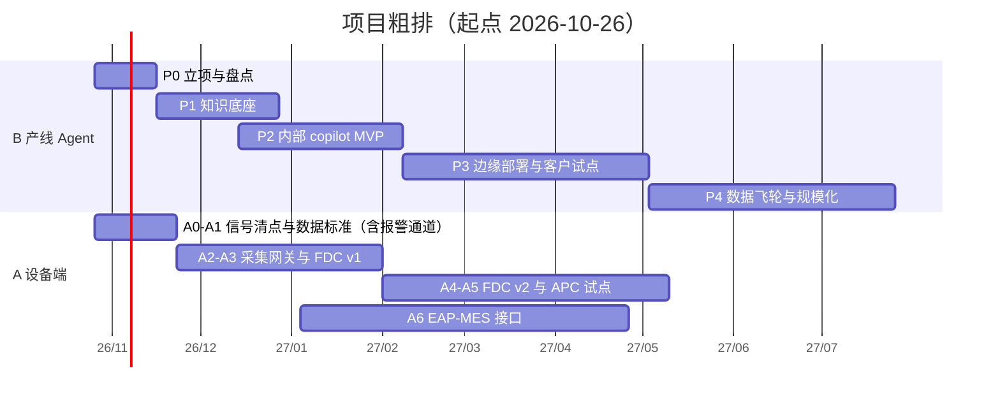

# 03 · 任务拆分与排期

> 排期是**粗估**，前提：核心团队 3–5 人（PM / 架构 1，数据 / ML 1–2，软件 1，工艺 / 售后专家半职 1），设备端另有团队。P0 结束后按实际资源重排。
> 数字类验收目标（%）均为**初始假设**，须在 P1 测出基线后修正。
> v0.2：首发范围收敛为**干法设备垂直切片**（建议 boron diffusion 先行），新增**报警驱动推送**与**数据安全**任务；设备端**报警通道**提前。

## 总览

> 2027 年春节前后（2 月上旬）通常有 2–3 周产能下降，排期已有部分缓冲但仍需关注。

---

## Track B：产线 Agent

### P0 立项与盘点（第 1–3 周）

| ID | 任务 | 交付物 | 验收 |
|---|---|---|---|
| P0-1 | 选定首发切片：干法设备（建议 boron diffusion 先行，依报警 / 工单频次最终确认），含两个入口：报警驱动、对话排障 | 一页范围说明 | 3 位售后 / 设备专家确认该场景频次高、痛点真实 |
| P0-2 | 售后数据盘点 + 200 条抽样质检 | 数据盘点表、质量报告 | 清楚“四要素齐全率”和“有结果标签比例” |
| P0-3 | Taxonomy workshop | 症状 / 工序段 / 根因 / 报警分类 v1 | 专家签字；覆盖抽样中 ≥90% 的案例 |
| P0-4 | 合规与合同梳理：客户在东南亚 / 欧洲 / 美国，分地区梳理数据保护、保密与技术资料出口要求；起草 DUA 模板 | 合同条款清单、DUA 草案 | 法务 review 完成 |
| P0-5 | 成功指标定义 | 指标表（见下） | 管理层确认 |
| P0-6 | 数据分级与 LLM 使用政策（以 `06` 为起点） | 政策文档 | 管理层与法务确认 |

**初始指标（假设值）**
- Top-3 根因命中率（内部评测集）≥ 60%
- 有害 / 越权建议率 = 0（L2/L3 动作未经批准不输出具体数值）
- 平均到达首条可执行建议的对话轮数 ≤ 5
- 该转人工的案例被正确转人工比例 ≥ 90%
- 报警推送：匹配到 playbook 的报警在预定时间内送达率 100%（含 LLM 不可用时的模板消息）

### P1 知识底座（第 3–9 周）　依赖：P0

| ID | 任务 | 交付物 | 验收 |
|---|---|---|---|
| P1-1 | case card schema v1 | `schemas/case_card.schema.json` 定稿 | 抽样 20 条可无损填写 |
| P1-2 | 抽取流水线（LLM 辅助 + 人审，**自托管环境**） | 首批高质量 case card（目标数量待 P0-2 后定） | 审核通过率、字段完整率达标 |
| P1-3 | 评测集 | ≥100 条带标准答案的真实场景（含历史工单回放、“应转人工”负例） | 覆盖主要症状与报警；与训练 / 检索库隔离 |
| P1-4 | 结构化知识 v0 | Top-10 症状规则树、参数窗口表 | 专家审核 |
| P1-5 | 文献 / 手册摄取 | RAG 语料 + 版权 / 许可清单 | 每篇有出处与许可状态 |
| P1-6 | 检索基线 | 报警码精确索引 + 向量 / 关键词混合检索 + 重排 | Recall@k 有基线数值 |
| P1-7 | LLM 选型评测 | 候选 ≥3（开源权重；中英文；工具调用；目标 GPU 上的延迟与显存）；另测大模型作“能力上限”参照（仅用脱敏数据）。客户可放 GPU，不必局限极小模型，选“够用的最小” | 选型报告；**以实测定，不先拍板** |
| P1-8 | **Alarm Playbook v0**（目标切片） | 报警手册条目（见 `07` 示例） | 覆盖历史报警量的约定比例；100% 专家审核 |
| P1-9 | **图纸 / 手册索引库 + 设备台账** | 元数据索引、as-built 台账 | 图纸版本与设备配置可对应 |
| P1-10 | **全线工艺因果表** | 症状 ↔ 工序 ↔ 设备状态（含湿法、金属化等上下游影响） | 工艺专家审核 |

**Gate G1**：评测集 + 检索基线 + 选型报告 + playbook v0 完成。

### P2 内部 copilot MVP（第 8–16 周）　依赖：P1

| ID | 任务 | 交付物 | 验收 |
|---|---|---|---|
| P2-1 | 对话编排（状态机 + LLM） | 可运行服务 | 走通 `01` 中 8 步流程 |
| P2-2 | 引导提问策略 | 按信息增益排序的追问逻辑 | 评测集上轮数下降 |
| P2-3 | 多模态入口 | 图片 / CSV / 截图上传与解析 | 格式覆盖主流样例 |
| P2-3a | EL / 外观缺陷分类 CV 模型 | 分类器 + 标注规范 | 留出集上有明确精度；**图像理解交给专用模型** |
| P2-4 | 输出模板 | 步骤 + 判定标准 + 风险 + 置信度 | 专家盲审可读、可执行 |
| P2-5 | 安全护栏与红队 | L0–L3 动作分级；红队用例（含提示注入、跨租户泄露、越权推送） | 红队用例零越权 |
| P2-6 | 内部灰度 | 售后工程师日常使用；记录采纳 / 修改 / 忽略 | 持续 4 周 |
| P2-7 | 周度评测迭代 | 评测看板 | 指标趋势向好 |
| P2-8 | **报警推送服务** | 去重 / 风暴抑制、playbook 匹配、模板消息 + LLM 措辞、多渠道推送 | 回放历史报警，推送内容经专家审核；**LLM 关闭时仍能送达** |
| P2-9 | **推送反馈闭环** | “有用 / 无用 / 已解决 + 实际根因”采集，回写 case card | 反馈可结构化入库 |

**Gate G2**：评测达到 P0-5 指标 + 内部使用 4 周 + 零重大安全事件。

### P3 边缘部署与客户试点（第 16–28 周）　依赖：G2

| ID | 任务 | 交付物 | 验收 |
|---|---|---|---|
| P3-1 | 边缘包 | 容器化部署、离线 / 弱网可用、GPU 最小规格清单 | 在测试环境一键安装 |
| P3-2 | 知识包与模型权重签名 / 版本 / 回滚 | 发布与更新机制 | 回滚演练通过 |
| P3-3 | 脱敏 + 授权闸门 + 出站防火墙 + 审计日志 + 收件人白名单 | 可用实现 | 脱敏用例集全通过；出站默认拒绝 |
| P3-4 | 转人工通道 | 上下文数据包 + 工单对接 | 售后工程师接单无需重复询问 |
| P3-5 | 1–2 家友好客户试点（先签 DUA） | 试点报告 | 现场稳定运行 ≥8 周 |
| P3-6 | 试点复盘 | 解决率、节省工程师小时、客户满意度 | 与基线对比有改善 |
| P3-7 | 多语言与跨时区转人工 | 语言覆盖清单、排班方案 | 在东南亚 / 欧洲 / 美国时段均有响应路径 |

**Gate G3**：试点客户愿意续用，且数据回流机制跑通。

### P4 数据飞轮与规模化（第 28 周起）

| ID | 任务 |
|---|---|
| P4-1 | case card 自动回流 + 审核队列 |
| P4-2 | 知识包月度发布节奏 |
| P4-3 | 漂移监控（新机型 / 新材料 / 新工艺） |
| P4-4 | 评估联邦学习 / 客户侧 LoRA 微调是否有必要 |
| P4-5 | 与 Track A 对接：Agent 直接查询 FDC，不再依赖客户手工提供 |
| P4-6 | 复制到其余干法设备（LPCVD、POCl3 diffusion、oxidation、laser opening） |
| P4-7 | 商业化：定价、SLA、客户成功流程 |

---

## Track A：设备端增配

| ID | 任务 | 交付物 | 验收 |
|---|---|---|---|
| A0 | 信号清点（按设备品类） | 信号清单 + 缺口 + 优先级排序 | 与工艺专家确认 Top 信号 |
| A1 | 数据采集标准 + **报警通道（alarm-only）先行** | 协议选型、时间同步、命名规范、**数据字典（与 case card、playbook 对齐）**；报警最小字段：设备号、报警码、时间、配方 / 批次 / 管号 | 评审通过 |
| A2 | 报警通道上线 + 边缘采集网关 + 时序存储 | 网关软件 + 保存 / 压缩策略；客户不开放接口时的降级方案（日志监听 / HMI 导出 / 邮件） | 1 台设备连续稳定采集 ≥4 周 |
| A3 | FDC v1 | 阈值报警 + 趋势 + SPC 控制图（单变量） | 误报率 / 漏报率有基线 |
| A4 | FDC v2 | 多变量检测 + 故障分类，对接 Agent 知识库 | 历史故障回放中检出率达标 |
| A5 | APC 试点（1 个回路） | R2R 控制器，先建议模式后闭环；护栏（上下限、日志、回退） | 建议模式下 4 周，推荐值被采纳且指标改善 |
| A6 | EAP / MES 接口 | 配方管理、追溯 ID、状态上报；与客户 MES 对接 | 1 家客户联调通过 |
| A7 | 老设备 retrofit 方案与报价 | 改造包 SKU、报价模板 | 销售可独立报价 |

**Gate A-G1**：A3 在 ≥1 台设备稳定运行 4 周，才进入 A4 / A5。
