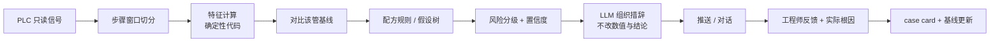

# 08 · 信号驱动诊断（以 Leak Check 为首个配方）

> v0.4 新增。本文的诊断逻辑是**按真空系统通用原理 + 你给出的三个例子整理的 v0 假设树**，没有用你们的真实 recipe、报警表和历史记录验证过。**所有阈值、判定、处理建议都必须由工艺 / 设备工程师审核、并用历史数据校准后才能使用。**

## 1. 这是什么，和前两类入口有什么不同

| 入口 | 触发 | 输入 | 现状 |
|---|---|---|---|
| 报警驱动（`07`） | 设备已报警 | 报警码 + 当前状态 | V1 主打 |
| 对话排障（`01`） | 客户提问 | 文字 / 图片 / 数据 | V1 |
| **信号驱动（本文）** | **设备在运行，信号走势异常或某步骤结果不好** | **PLC 实时 / 历史信号** | **新增，依赖 Track A 的信号通道** |

信号驱动诊断带来两种新能力：

1. **预警**：步骤还没失败，但趋势显示风险在上升（例如 leak rate 在变差）。
2. **失败后判因**：步骤失败时，用信号形状判断更可能是哪一类原因，并给出区分用的验证动作。

它本质上是“带领域知识的 FDC”：判断由确定性代码完成，Agent 负责解释与引导。

## 2. 通用架构：诊断配方（Diagnostic Recipe）

每一种诊断（leak check、温度曲线偏离、气体流量偏离……）都写成一份**诊断配方**，由专家审核、版本化：

| 配方要素 | 内容 |
|---|---|
| 触发 | 哪个工艺步骤 / 时间窗（由 PLC 步骤号和时间戳界定） |
| 信号 | 需要读哪些点位、采样频率要求 |
| 特征 | 从信号算出的数值（斜率、曲线形状、到达时间……） |
| 基线 | **每个管 / 每台设备**自己的历史基线，而不是只用一个全局阈值 |
| 判定 | 规则（v1）；数据足够后才评估统计 / 机器学习模型 |
| 假设树 | 形态 → 可能原因 → 区分用的验证动作 → 处理建议（含风险等级） |
| 输出模板 | 观察到的数值、判断、置信度、验证步骤、升级条件 |
| 证据 | 来源（手册、案例、专家）、适用范围、有效期 |



**两条硬规则**

- **数值判断不交给 LLM。** 斜率、阈值、趋势、分型都由代码算；LLM 只能引用这些结果来组织语言，不能自己“估算”。
- **阈值和规格不由 Agent 决定。** 规格取自设备 recipe / 工艺文件；Agent 永远不建议放宽规格、跳过 leak check 或在失败后继续生产（L3）。

## 3. 首个配方：Leak Check

### 3.1 需要先向工程师确认的假设

我假设该步骤的做法是：抽到基础真空 → 关闭抽气（隔离）→ 保持一段时间 → 看压力上升 → 计算 leak rate（压力上升速率，单位以你们为准）→ 与规格比较。**你们的实际步骤逻辑、隔离方式、保持时间、单位、规格、LPCVD 与 boron diffusion 是否都是低压管**，都要在 C0 确认。

### 3.2 需要的信号

| 信号 | 用途 | 备注 |
|---|---|---|
| 管内压力（原始值） | 计算 leak rate、看曲线形状 | **关键：要原始曲线，不能只有结果** |
| 步骤号 / 时间戳 | 切分 leak check 窗口 | |
| 隔离阀 / 节流阀 / 前级阀 / 进气与吹扫阀状态 | 区分阀门内漏与真实漏 | |
| 真空泵状态（电流、前级压力等，视设备而定） | 区分“抽不下去”与“漏” | |
| 管温（各温区） | 看 leak rate 是否与温度相关 | |
| 炉门 / 法兰状态 | 区分密封问题 | |
| 维护记录：上次开门、换管、换密封件、清洁 | 解释水分类原因 | 来自工单或台账 |
| 运行次数（距上次清洁 / 维护） | 趋势背景 | |
| 环境湿度（若有） | 辅助水分判断 | 可选 |
| 同一管历史 leak check 结果 | 基线与趋势 | |

### 3.3 特征

- **leak rate**：在定义好的窗口内对压力做线性拟合得到的斜率。
- **曲线形状**：上升是持续线性，还是前快后慢（逐渐变平）。前者更像真实漏，后者更像放气（水分 / 脱附）。
- **基础真空与抽气时间**：是否达到历史水平，耗时是否变长。
- **与基线的偏差**：相对该管最近若干次的中位数。
- **复测一致性**：连续两次 leak check 是否一致，吹扫后是否改善。
- **噪声与偏置**：传感器读数是否稳定、零点是否漂移。
- **温度相关性**：leak rate 是否随温度变化。

### 3.4 部分 A：慢漏风险（趋势预警）

场景：leak check 目前**通过**，但在变差。

做法（v1，规则 + 统计，不上黑盒模型）：

- 对每个管的 leak rate 做 EWMA / CUSUM 之类的漂移检测，并估计“按当前斜率还有多少次运行会逼近规格”。
- 输出三档：绿（正常）/ 黄（漂移，建议下次维护时检查）/ 红（接近规格，建议尽快处理）。
- 作为**预警**（pre-alarm）推送，与真实报警区分，不触发停机建议。

**要诚实说明的限制**：“慢漏会在失败前先出现趋势”是一个假设，不是事实。是否成立、预警能提前多久，要靠 C2 用你们的历史数据验证。验证通过前，对外只说“检测到趋势变化”，不说“预测会失败”。

### 3.5 部分 B：Leak check 失败后的判因（假设树 v0）

先看四个量：**leak rate、曲线形状、基础真空是否达到、抽气时间**。

| # | 信号形态 | 更可能的原因 | 区分用的验证 | 处理建议（风险等级） |
|---|---|---|---|---|
| 1 | leak rate 偏高，曲线前快后慢；复测或吹扫后明显改善；常出现在开门、换管、维护、长时间停机之后 | **水分 / 放气（虚漏）** | 复测一次；执行已批准的吹扫流程后再测 | 执行**已批准**的 N2 吹扫 / 烘烤流程并复测（L1）；**有次数上限**，超限转人工；修改吹扫参数属 L2 |
| 2 | leak rate 偏高，曲线基本线性；吹扫后基本不变 | **小的真实漏**：炉门 O 型圈、法兰、接头、焊缝 | 氦检漏；检查密封件状态 | 检查 / 更换密封件、复紧接头（L1–L2，按工程师确认）；氦检漏由专业人员执行（L2） |
| 3 | 压力上升很快，或根本抽不到基础真空，而泵运行正常 | **大漏**：维护后某处**接管没接好 / 法兰未压紧**、炉门未密封、部件破裂、某阀门卡在开启位 | 检查最近是否做过维护；核对炉门和各阀状态；分段隔离排查 | 复查最近动过的接口和阀门（L1）；涉及管路拆装为 L2 |
| 4 | 抽不到基础真空 / 抽气变慢，但**隔离后压力上升很慢** | **不是漏，是抽气能力问题**：前级管路或捕集阱被副产物**堵塞**、泵性能下降、节流阀没有全开 | 对比抽气时间、前级压力、泵电流与历史；隔离后速率是否正常 | 检查前级管路 / 捕集阱 / 泵（L1–L2）；清堵或维护泵属 L2 |
| 5 | 读数噪声大或有偏置，抽到底也不稳定 | **压力计 / 信号故障** | 对比冗余压力计；检查零点与接线 | 检查 / 校准 / 更换压力计（L1–L2） |
| 6 | leak rate 与隔离阀动作强相关，隔离不严 | **阀门内漏**（隔离阀 / 前级阀关不严）或泵回流 | 检查阀门状态反馈与动作；检查单向阀 | 检查 / 更换阀门（L2） |
| 7 | leak rate 随温度升高而变差 | 热态放气或受热后的密封泄漏 | 在不同温度下复测 | 工程师评估（L2） |

说明：

- **你说的“抽真空堵住”**在信号上通常**不表现为 leak rate 高**，而是“抽不下去 / 抽得慢”，所以我把它放在第 4 行，用“隔离后上升速率是否正常”来和漏区分。
- **慢漏 ≠ 一定是水分。** 你的例子（慢漏→吹扫去水分）成立于第 1 行；但慢漏也可能是第 2 行的小真漏。区分办法是吹扫后看是否改善。如果一律建议“再吹扫”，真漏会被反复耽误，所以必须有**次数上限**。
- 同一时刻可能有多个原因叠加，输出应给出**排序的候选 + 置信度**，而不是唯一结论。
- 具体到 LPCVD 与 boron diffusion，管路、副产物、气体不同，分型和建议要分别审核。

### 3.6 输出示例（占位）

```
【预警】<设备号> · <管号> · Leak check 趋势
观察：近 <N> 次 leak rate 缓慢上升，当前为该管基线的 <x> 倍（规格内）。曲线形状：<线性 / 前快后慢>。
判断：趋势变差，<置信度>。可能与密封件老化或近期维护后的放气有关（待验证）。
建议：1) 下次开门前后留意 leak check 是否反复；2) 在计划停机时检查 <部位>（L1）。
说明：这是趋势提示，尚不构成故障。
```

```
【Leak check 失败】<设备号> · <管号>
安全：先按现场 SOP 确认设备处于安全状态；涉及易燃 / 有毒 / 腐蚀性气体的管路，不要在通气状态下查漏。
观察：leak rate <数值> / 规格 <数值>；曲线形状 <…>；基础真空 <达到 / 未达到>；抽气时间 <…>。
候选原因（排序）：
  1) <原因>（置信度 <…>）
  2) <原因>（置信度 <…>）
验证：先做 <低风险验证动作>，结果 A → … ；结果 B → …
处理：<步骤，含风险等级>
升级：<已执行 N 次处理仍失败 / 涉及管路拆装 / 无法判断> → 联系厂商
```

### 3.7 安全

- Leak check 失败的管路可能涉及易燃、有毒或腐蚀性气体（视工艺而定）。**安全状态永远排第一。**
- 查漏、拆装接管、氦检漏等属 L2；涉及气体通入状态下查漏，一律 L3 转人工。
- Agent **不建议**：放宽规格、跳过 leak check、失败后继续投料。
- 吹扫 / 烘烤只推荐**已批准的标准流程**；改参数属 L2，只提示“需工程师批准”，不给数值。

## 4. 数据现实检查（C1 要回答的问题）

这些问题的答案决定能做到哪一层：

1. PLC / 上位机里保存的是**leak check 的原始压力曲线**，还是**只有最终结果（数值或通过 / 失败）**？
   - 只有结果：可以做趋势预警，**做不了**曲线形状分型。
   - 有曲线：两者都能做。
2. 采样频率和保存时长是多少？分辨率够不够区分慢漏？
3. 历史有多少次 leak check？**失败有多少次？每次失败后实际处理了什么、结果如何？**
4. 是否有统一的管编号、维护记录能与 leak check 对上？
5. 不同客户 / 不同设备的 leak check 规格和做法是否一致？

失败事件通常**很少**（类别不平衡），所以 v1 用规则 + 统计，机器学习要等有足够带结果标签的事件再评估。

## 5. 扩展到其他配方（候选，需与工程师确认优先级）

| 候选配方 | 价值 | 前提 |
|---|---|---|
| 各温区温度曲线偏离 / 热电偶漂移 | 直接影响均匀性与良率 | 温度曲线可读 |
| 气体流量（MFC）偏离 | 影响膜厚 / 掺杂 | 设定值与实测值可读 |
| 压力控制偏离（节流阀） | 工艺稳定性 | 阀位与压力可读 |
| 推舟 / 舟位异常、碎片相关 | 碎片率 | 运动信号可读 |
| 冷却水 / 排风状态 | 安全与稳定 | 状态信号可读 |

每新增一个配方都走 C0–C5 的模板流程。

## 6. 压力测试

1. **“预测慢漏”可能被高估。** 没有历史数据证明趋势先于失败之前，只能做“趋势变化检测”。C2 是关卡，未通过就降级。
2. **只有结果、没有曲线**是很常见的现实，会让分型能力大打折扣。先摸底再承诺。
3. **误判水分的代价**：把真漏当水分反复吹扫，会耽误处理并消耗产能。对策：次数上限 + 吹扫后的改善判据。
4. **类别不平衡与标签噪声**：失败样本少，人工记录的“原因”未必准确。对策：规则先行，专家复核标签。
5. **基线漂移 vs 真实劣化**：维护或换件后基线会变，要在维护事件后重置 / 重建基线。
6. **传感器本身**：分辨率、量程、零点漂移会制造假趋势。
7. **规格与做法因客户而异**：配方要参数化，不要硬编码。
8. **客户改了 recipe**：版本不一致会让特征失真，需要读取 recipe 版本。
9. **误报疲劳**：预警必须克制，黄档只做低打扰提示。
10. **LLM 数值幻觉**：数值全部由代码提供，LLM 输出做数值一致性校验。

## 7. 对应任务

见 `03-roadmap-tasks.md` 的 Track C（C0–C7）。
